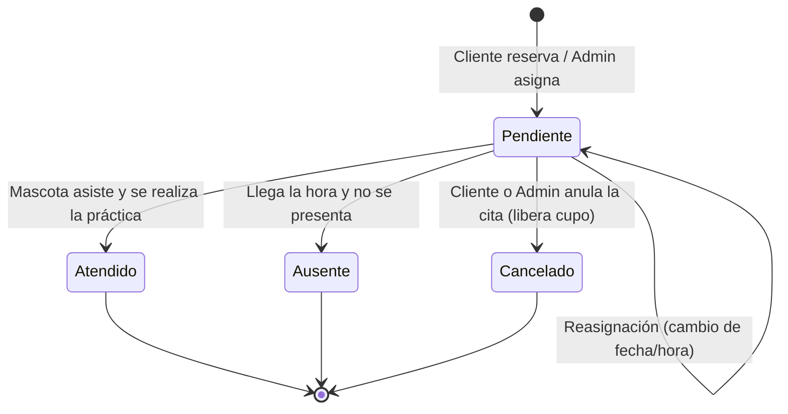
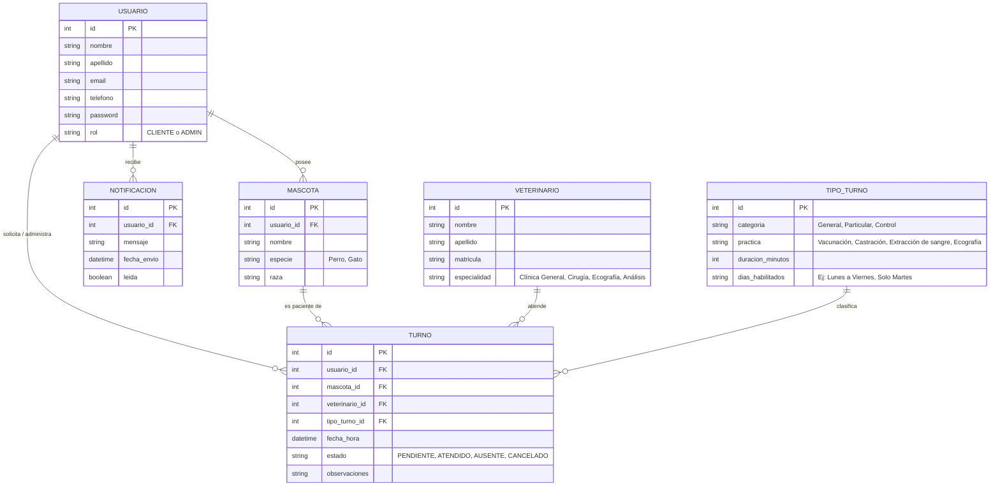

# Modelo de Datos y Ciclo de Vida del Turno - Veterinaria de Animales Chicos

## 1. Ciclo de Vida del Turno (Estados)

Un turno no solo existe, sino que va cambiando de condición a lo largo del tiempo:

* **Pendiente (u Ocupado):** El cliente ya reservó el horario. El sistema bloquea la agenda para que ningún otro usuario pueda elegir ese mismo día y hora. El turno se queda esperando a que llegue el día de la cita.
* **Atendido (Confirmado / Atendido):** El día del turno, la mascota asiste a la veterinaria y el médico realiza la práctica (castración, ecografía, consulta, etc.).
* **Ausente:** Llegó la hora del turno y el cliente no se presentó. El sistema lo marca así para llevar estadísticas de cumplimiento.
* **Cancelado:** El cliente o el administrador anularon la cita antes de tiempo. En ese instante, **el horario vuelve a quedar libre y disponible** en el sistema para otra persona.

### Diagrama de Estados

---

## 2. Diagrama Entidad-Relación (DER)

